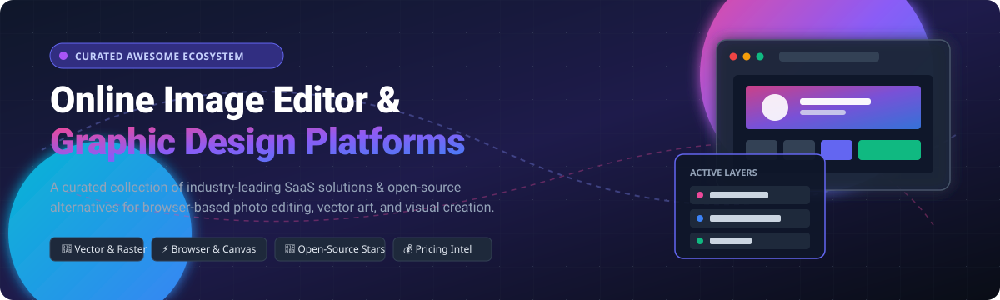

  

# 🎨 Awesome Online Image Editor & Graphic Design Platforms

  
  
  
  
  
  

> 🚀 **A comprehensive, SEO-optimized curated directory of top Online Image Editors, Browser Graphic Design Platforms, and Open-Source Canva/Photoshop Alternatives.** Compare enterprise valuations, starting tier pricing, free tier limits, canvas technologies, and GitHub star metrics for photo editing, vector graphics, and digital artwork.

---

## 📑 Table of Contents

- [📈 Sector Overview & Market Dynamics](#-sector-overview--market-dynamics)
- [☁️ SaaS / Hosted Platforms](#️-saas--hosted-platforms)
- [💻 Open-Source Software](#-open-source-software)
- [📊 Feature Comparison Matrix](#-feature-comparison-matrix)
- [⭐ Star History](#-star-history)
- [🤝 Contributing](#-contributing)
- [💖 Support](#-support)
- [📄 License](#-license)

---

## 📈 Sector Overview & Market Dynamics

The global graphic design and online image editing software market is valued at approximately **$9.3B – $10.1B**, projected to grow at a **9.5% CAGR** driven by cloud migration, e-commerce visual assets, and generative AI workflow automation.

The sector demonstrates **moderate-to-high concentration** at the top tier: enterprise incumbents like Adobe ($85B+ market cap) and Canva ($42B private valuation) capture the majority of global commercial design demand in a semi-consolidated "winner-takes-most" ecosystem, while a **vibrant, fragmented long tail** of bootstrapped indie utilities (e.g., Photopea) and privacy-first, self-hostable open-source platforms (Penpot, Excalidraw, tldraw) thrive by serving specialized developer, team collaboration, and local-first offline niches.

---

## ☁️ SaaS / Hosted Platforms

Below is the structured breakdown of the top commercial, browser-first design and photo editing suites, sorted in descending order by company valuation / market capitalization.

| Rank | Platform | Valuation / Company Scale | Starting Tier Price | Free Tier Limits | Primary Focus & Capabilities |
|:---:|:---|:---|:---|:---|:---|
| 1 | **Adobe Express** | **~$85B – $95B Market Cap** *(NASDAQ: ADBE; parent company)* | **$9.99 / month** (Annual or Monthly billing) | **Free Forever**: 5 GB cloud storage, 25 monthly generative AI credits (Adobe Firefly), thousands of free templates, Adobe Fonts access; watermarks on premium assets. | Full-fledged creative suite integrating Adobe Stock, font ecosystems, and generative AI templates. |
| 2 | **Canva** | **$42 Billion Valuation** *(2025 secondary valuation; $3.5B+ annual revenue)* | **$15.00 / month** (or $120.00 / year billed annually) | **Free Forever**: 5 GB cloud storage, 1M+ free design templates, 5M+ free photos/graphics; strictly limited to 3 brand colors, 50 lifetime AI Magic Studio uses, no background remover. | Template-first visual suite for non-designers, social media graphics, presentations, and marketing collateral. |
| 3 | **PicMonkey** | **$110 Million** *(Acquired by Shutterstock in cash)* | **$7.99 / month** (or $72.00 / year Basic) | **7-Day Free Trial Only**: Full preview editing tools with 1 GB storage; strictly zero image exports/downloads permitted without active subscription or trial payment method. | Photo editing, retouching, and marketing templates deeply plugged into the Shutterstock asset library. |
| 4 | **VistaCreate** | **$85 Million** *(Acquired with Depositphotos by Cimpress / Vistaprint)* | **$10.00 / month** (or $120.00 / year Pro, covers up to 10 team seats) | **Free Forever**: 10 GB cloud storage, 100K+ free design templates, 1M+ free photos & vectors; excludes automatic background removal, team seats, and brand kits. | Multi-format template design suite optimized for print-ready collateral, ads, and digital social posts. |
| 5 | **Polarr** | **$46 Million Valuation** *(Post-Series A venture backing; ~$3M ARR)* | **$3.99 / month** (or $23.99 / year Studio) | **Free Forever**: Unlimited basic global adjustments (curves, color HSL, light, crop, basic presets); export blocked/watermarked if selective masks, face touchups, or AI tools are used. | Advanced browser and mobile photo adjustment engine with facial recognition, color grading, and selective filters. |
| 6 | **Photopea** | **~$15M – $20M Est. Valuation** *(Bootstrapped solo dev Ivan Kutskir; ~$2.5M–$3M ARR)* | **$9.00 / month** (or $40.00 / year Premium pass) | **Free Forever**: 100% full feature parity with Premium (PSD/AI/Sketch parsing, layers, smart objects, masks, local compute); ad-supported sidebar with 0.5 GB PeaDrive cloud storage. | In-browser Photoshop alternative capable of reading and editing Photoshop PSD, Illustrator AI, and Sketch files offline. |
| 7 | **Pixlr** | **~$10M – $15M Est. Valuation** *(Inmagine Group subsidiary; ~$9.1M ARR)* | **$1.99 / month** (Plus) or **$7.99 / month** (Premium) | **Free Forever**: 3 image saves/downloads per day, basic editing tools, ad-supported interface; capped resolution on large exports and restricted AI generation credits. | Split editing engine (Pixlr E for layered Photoshop-like adjustments, Pixlr X for rapid Canva-style templates). |
| 8 | **Fotor** | **~$8M – $12M Est. Scale** *(Everimaging / Chengdu Hengtu; ~$3M ARR)* | **$8.99 / month** (or $39.99 / year Pro) | **Free Forever**: Basic photo adjustments, college maker, and basic templates; exports contain watermarks on premium assets, max resolution capped, ads present. | AI-enhanced photo editing, background removal, beauty portrait retouching, and graphic collages. |
| 9 | **Snappa** | **~$6M – $10M Est. Scale** *(Bootstrapped SaaS; ~$3.2M ARR)* | **$15.00 / month** (or $120.00 / year Pro) | **Free Forever**: Strictly capped at **3 image downloads per month** (previously 10), 1 user seat, access to basic templates; excludes social sharing and custom fonts. | Lightweight, high-velocity graphic design utility engineered specifically for bloggers and marketers. |
| 10 | **BeFunky** | **~$5M – $8M Est. Scale** *(Bootstrapped / Angel funded; ~$2M ARR)* | **$9.99 / month** (or $59.88 / year Plus) | **Free Forever**: 125 basic photo effects and standard collage layouts; downloads watermarked for premium assets, advanced "artsy" filters and AI cutout locked. | Intuitive triple-engine platform combining Photo Editor, Collage Maker, and Graphic Designer modules. |

---

## 💻 Open-Source Software

The open-source design ecosystem provides powerful alternatives ranging from browser collaborative suites to desktop production editors. 

Repositories are listed in **descending order of GitHub star count**. Each project includes a white social star badge directly linking to its stargazers page.

---

### 1. 🌟 [Excalidraw](https://github.com/excalidraw/excalidraw)

* **Repository:** `excalidraw/excalidraw`
* **Tech Stack:** TypeScript / React / Canvas API
* **License:** MIT
* **Description:** An open-source virtual whiteboard and diagramming editor with a distinctive hand-drawn aesthetic. Supports infinite canvas navigation, live end-to-end encrypted collaboration, customizable element styling, wireframing, and SVG/PNG exports.
* **Best For:** Brainstorming, architectural design, wireframing, and quick visual sketching in teams.

---

### 2. 🌟 [Penpot](https://github.com/penpot/penpot)

* **Repository:** `penpot/penpot`
* **Tech Stack:** Clojure / ClojureScript / SVG / Web Standards
* **License:** MPL-2.0
* **Description:** The first open-source, web-based design and prototyping tool built natively on open web standards (SVG, CSS Grid, Flexbox). Provides design systems, shared component libraries, interactive prototypes, and developer handoff inspect views without vendor lock-in.
* **Best For:** Product design teams seeking a fully self-hostable, open-source alternative to Figma.

---

### 3. 🌟 [tldraw](https://github.com/tldraw/tldraw)

* **Repository:** `tldraw/tldraw`
* **Tech Stack:** TypeScript / React / Canvas SDK
* **License:** Apache-2.0 / tldraw SDK license
* **Description:** A hyper-responsive infinite collaborative canvas and extensible visual editor SDK. Features rich freehand drawing, geometric shapes, sticky notes, arrows, real-time multi-user syncing, and an embeddable component architecture.
* **Best For:** Developers embedding a modern collaborative drawing canvas directly into React applications.

---

### 4. 🌟 [Fabric.js](https://github.com/fabricjs/fabric.js)

* **Repository:** `fabricjs/fabric.js`
* **Tech Stack:** JavaScript / HTML5 Canvas / Node.js
* **License:** MIT
* **Description:** A powerful JavaScript HTML5 canvas library that serves as the core foundation for thousands of online graphic design and image editing applications (including Canva-like clones). Adds an interactive object model over raw canvas, grouping, free-drawing, text warping, filters, and SVG serialization.
* **Best For:** Developers building custom web graphic design editors, merchandise customizers, and interactive canvases.

---

### 5. 🌟 [Cropper.js](https://github.com/fengyuanchen/cropperjs)

* **Repository:** `fengyuanchen/cropperjs`
* **Tech Stack:** JavaScript / CSS / HTML5
* **License:** MIT
* **Description:** The standard JavaScript image cropping component across the web. Delivers touch-friendly responsive cropping, aspect-ratio locking, zooming, rotating, scaling, free canvas repositioning, and client-side canvas rendering.
* **Best For:** Web photo crop utilities, avatar uploads, and lightweight embedded photo manipulation.

---

### 6. 🌟 [Krita](https://github.com/KDE/krita)

* **Repository:** `KDE/krita`
* **Tech Stack:** C++ / Qt / OpenGL
* **License:** GPL-3.0
* **Description:** A world-class open-source digital painting, illustration, and 2D animation studio. Features 9 brush engines with 100+ presets, brush stabilizers for freehand drawing, full vector tools, non-destructive layer masks, seamless texture wrapping, and HDR painting.
* **Best For:** Concept artists, digital illustrators, painters, and comic creators seeking a zero-cost professional studio.

---

### 7. 🌟 [draw.io](https://github.com/jgraph/drawio)

* **Repository:** `jgraph/drawio`
* **Tech Stack:** JavaScript / mxGraph / HTML5
* **License:** Apache-2.0
* **Description:** Enterprise-grade browser-based diagramming and flowcharting software. Operates completely client-side with zero tracking, connecting seamlessly to Google Drive, GitHub, OneDrive, and local offline files with deep shape libraries.
* **Best For:** Architecture diagrams, flowcharts, technical system designs, and business infographics.

---

### 8. 🌟 [TOAST UI Image Editor](https://github.com/nhn/tui.image-editor)

* **Repository:** `nhn/tui.image-editor`
* **Tech Stack:** JavaScript / HTML5 Canvas / Fabric.js
* **License:** MIT
* **Description:** A full-featured in-browser photo image editor component built with Canvas and Fabric.js. Features cropping, rotation, flip, free-drawing, lines, arrows, shape overlays, text editing, icon insertion, and rich image filters (vintage, blur, sepia, invert).
* **Best For:** Turnkey integration of an intuitive image editor modal into web applications and CMSs.

---

### 9. 🌟 [GIMP](https://github.com/GNOME/gimp)

* **Repository:** `GNOME/gimp`
* **Tech Stack:** C / GTK / GEGL
* **License:** GPL-3.0
* **Description:** The GNU Image Manipulation Program is the gold standard of open-source raster graphics editors. Provides advanced channel manipulation, bezier paths, extensive healing/clone brushes, customizable transform matrices, and GEGL high-bit depth color pipelines.
* **Best For:** Photographers, retouchers, and graphic designers wanting complete local desktop Photoshop-grade raster control.

---

### 10. 🌟 [Inkscape](https://github.com/inkscape/inkscape)

* **Repository:** `inkscape/inkscape`
* **Tech Stack:** C++ / GTK / SVG
* **License:** GPL-3.0
* **Description:** Professional vector graphics editor using W3C SVG as its native file format. Features node path editing, boolean operations, text kern and path flow, spiro curves, bitmap vectorization, and extension pipelines for technical drawing and digital art.
* **Best For:** Vector illustrators, logo designers, icon creators, and laser cutting / SVG fabrication.

---

### 11. 🌟 [miniPaint](https://github.com/viliusle/miniPaint)

* **Repository:** `viliusle/miniPaint`
* **Tech Stack:** JavaScript / HTML5 / CSS
* **License:** MIT
* **Description:** A lightweight, client-side online image editor that runs purely in the browser with zero server dependencies. Supports multiple transparent layers, blending modes, color adjustments, 40+ artistic effects, and offline PWA functionality.
* **Best For:** Privacy-focused users who need quick raster editing, image touchups, and layer blending without logins.

---

### 12. 🌟 [Filerobot Image Editor](https://github.com/scaleflex/filerobot-image-editor)

* **Repository:** `scaleflex/filerobot-image-editor`
* **Tech Stack:** TypeScript / React / Konva.js
* **License:** MIT
* **Description:** An embeddable React and vanilla JS image editor widget crafted by Scaleflex. Features responsive cropping with social aspect ratios, resizing, watermarking, text overlays, color grading filters, and theme customizability.
* **Best For:** Digital asset management (DAM), e-commerce backends, and user upload pipelines.

---

## 📊 Feature Comparison Matrix

| Project | Environment | Open-Source License | Layer Support | PSD Support | Self-Hostable | Ideal Use Case |
|:---|:---:|:---:|:---:|:---:|:---:|:---|
| **Excalidraw** | Browser / React | MIT | ❌ | ❌ | ✅ | Hand-drawn sketching & whiteboards |
| **Penpot** | Browser / Cloud | MPL-2.0 | ✅ | ❌ | ✅ | Web UI/UX design & prototyping |
| **tldraw** | Browser / Canvas | Apache-2.0 | ✅ | ❌ | ✅ | Infinite collaborative canvas |
| **Fabric.js** | Library (Canvas) | MIT | ✅ | ❌ | ✅ | Custom design editor engine |
| **Cropper.js** | Browser Widget | MIT | ❌ | ❌ | ✅ | Responsive image cropping |
| **Krita** | Desktop App | GPL-3.0 | ✅ | ✅ | ✅ | Professional digital painting |
| **draw.io** | Browser / Desktop | Apache-2.0 | ✅ | ❌ | ✅ | Technical diagrams & flowcharts |
| **TOAST UI** | Browser Widget | MIT | ✅ | ❌ | ✅ | Web photo editing component |
| **GIMP** | Desktop App | GPL-3.0 | ✅ | ✅ | ✅ | Raster photo manipulation |
| **Inkscape** | Desktop App | GPL-3.0 | ✅ | ❌ | ✅ | Native SVG vector design |
| **miniPaint** | Browser / PWA | MIT | ✅ | ❌ | ✅ | Zero-install raster editor |
| **Filerobot** | React / Widget | MIT | ✅ | ❌ | ✅ | E-commerce photo pre-processing |

---

## ⭐ Star History

---

## 🤝 Contributing

Contributions are warmly welcome! If you know of an awesome online image editor, graphic design tool, or canvas library that should be featured here:

1. 🍴 **Fork** this repository.
2. 🌿 Create a new feature branch (`git checkout -b feature/awesome-tool`).
3. 📝 Add your tool with a short description, license, stack, and direct GitHub links.
4. 🚀 Submit a **Pull Request** with clear details about why it belongs in the list!

*Please verify all open-source candidates are actively maintained and licensed under recognized OSI-compliant licenses.*

---

## 💖 Support

If this curated directory has helped you discover powerful creative tools or kickstarted your design workflow:

* ⭐ **Star** this repository on GitHub to help others find it!
* 🍴 **Fork** and share it across your social feeds and design communities.
* ☕ **Sponsor & Buy a Coffee:** You can support continuous maintenance and new awesome lists via the [GitHub Sponsors Dashboard](https://github.com/sponsors/ishandutta2007). Thank you for your generosity!

---

## 📄 License

This repository and curated collection are released under the [Creative Commons Zero v1.0 Universal](LICENSE) (Public Domain Dedication). All featured software products, trademarks, and logos belong to their respective creators.
